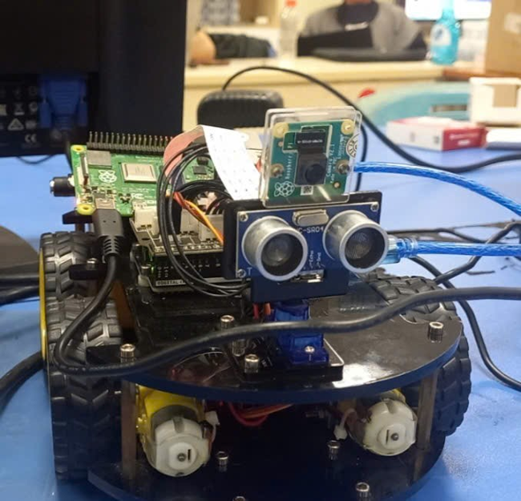
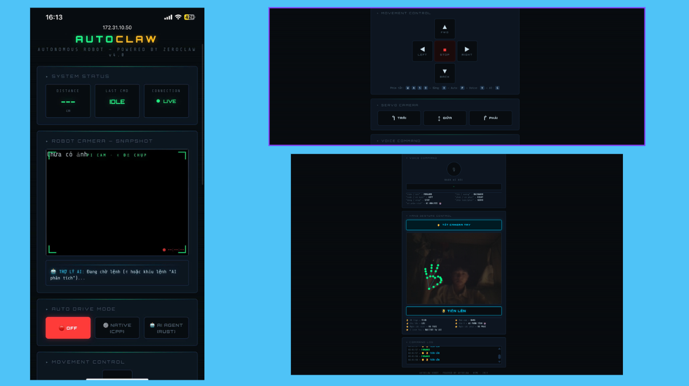
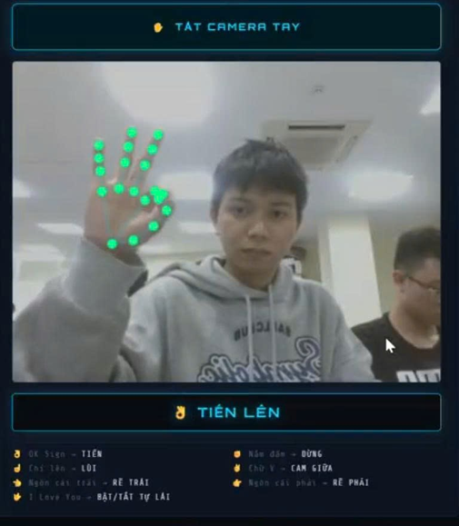
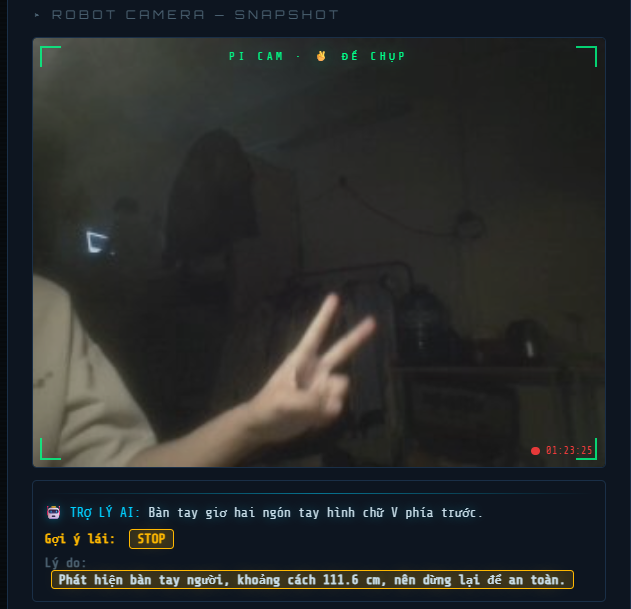
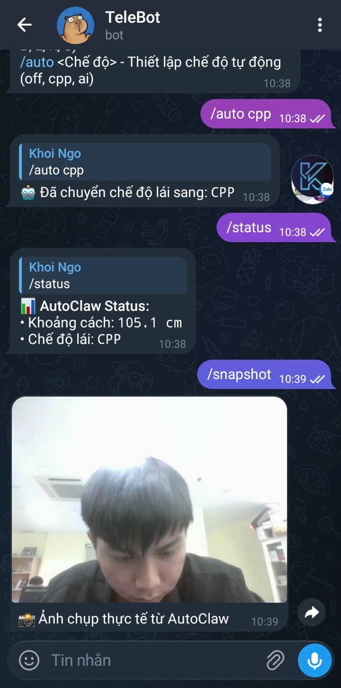
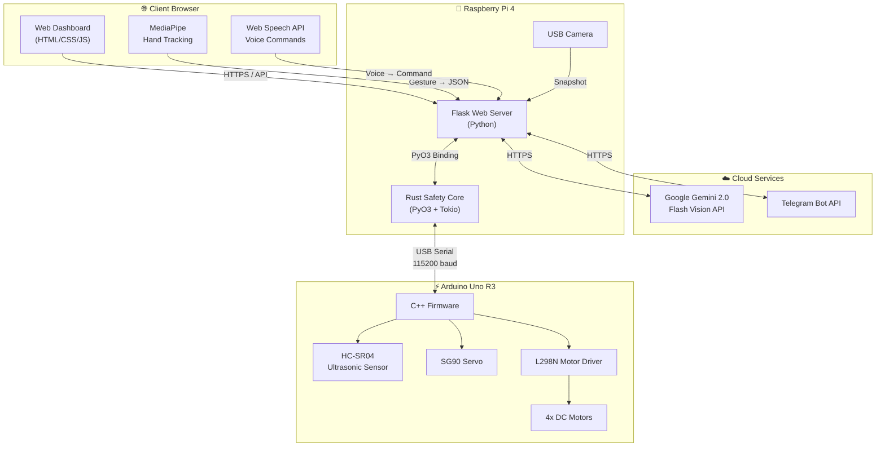
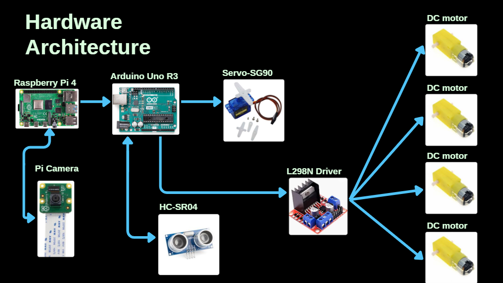
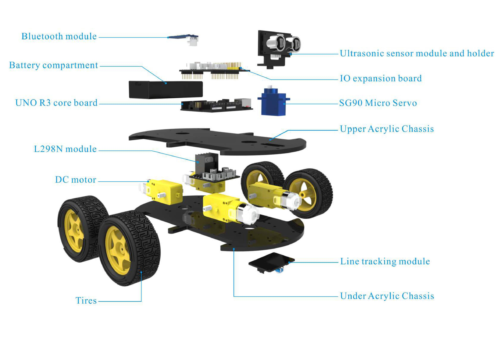

<div align="center">

# 🤖 AutoClaw

### Autonomous Edge AI Robot with Multimodal Control



An intelligent self-driving robot car powered by **Raspberry Pi 4** + **Arduino Uno R3**, featuring real-time obstacle avoidance, AI-powered vision analysis, hand gesture recognition, Vietnamese voice commands, and remote monitoring via Telegram — all controllable through a sleek Cyberpunk-themed web dashboard.

> 📚 *Academic Project — Faculty of Computer Networks & Communications, University of Information Technology (UIT), Vietnam*

[](https://python.org)
[](https://www.rust-lang.org)
[](https://flask.palletsprojects.com)
[](https://www.arduino.cc)
[](https://mediapipe.dev)
[](https://ai.google.dev)
[](https://core.telegram.org/bots)
[](https://www.raspberrypi.org)

</div>

---

## 📖 Overview

AutoClaw is a full-stack robotics project that transforms the **ELEGOO Smart Robot Car Kit** into an AI-powered autonomous vehicle. The system combines edge computing, computer vision, and natural language processing to create a robot that can be controlled through **5 independent interaction modes** simultaneously:

| Mode | Technology | Description |
| :---: | :--- | :--- |
| 🕹️ **Manual** | Web D-pad + Keyboard | Direct control via interactive Cyberpunk dashboard |
| 🎙️ **Voice** | Web Speech API | Vietnamese voice commands processed on-device |
| ✋ **Gesture** | MediaPipe (Client GPU) | Real-time hand gesture recognition via webcam |
| 🤖 **AI Patrol** | Gemini 2.0 Flash Vision | Autonomous navigation with visual reasoning |
| 📱 **Telegram** | Telegram Bot API | Remote monitoring & control from anywhere |

---

## ✨ Key Features

### 🛡️ Safety Reflex — Hardware-Level Emergency Braking
A **Rust-powered safety core** continuously monitors the ultrasonic sensor cache. When a forward command (`F`) is issued and an obstacle is detected within **15 cm**, the system **instantly overrides** it to a stop command (`S`) — bypassing all software layers for zero-latency collision prevention.

### 🧠 AI Vision Assistant — Gemini 2.0 Flash
Trigger with a ✌️ hand gesture or voice command. The robot captures a snapshot, sends it to **Google Gemini 2.0 Flash Vision API**, and receives back a detailed scene description in Vietnamese along with a recommended driving action — complete with reasoning displayed on the dashboard.

### ✋ Client-Side Hand Tracking — MediaPipe
Hand gesture recognition runs **entirely on the client's GPU** via WebGL using MediaPipe Tasks Vision SDK. No server-side processing needed. 7 gesture commands mapped to vehicle controls with custom geometry-based detection for maximum accuracy.

### 🎙️ Vietnamese Voice Control — Web Speech API
Built-in speech recognition supporting natural Vietnamese commands. Operates directly in the browser with zero server overhead. Supports movement, camera rotation, auto-drive toggle, and AI analysis triggers.

### 🔧 Rust + Python Hybrid Architecture — PyO3 Binding
The performance-critical safety core and autonomous agent loop are written in **Rust** (compiled via **Maturin/PyO3**), while the web server and orchestration layer use **Python/Flask** — combining Rust's memory safety with Python's ecosystem flexibility.

### 📱 Telegram Bot — Remote Command Center
Full remote control and monitoring through Telegram. Send movement commands, check sensor readings, capture live snapshots, and switch driving modes — all secured with Chat ID authentication.

---

## 📸 Screenshots & Demo

<div align="center">
  
  <p><em>🖥️ Cyberpunk-themed Control Dashboard (Mobile Responsive & Desktop Interface)</em></p>
</div>

<br/>

<table>
  <tr>
    <td align="center" width="50%">
      
      <br/>
      <b>✋ Real-Time Hand Gesture Recognition (Client GPU)</b>
      <p><i>MediaPipe 21-landmark tracking with custom geometry (👌 OK Sign → Move Forward)</i></p>
    </td>
    <td align="center" width="50%">
      
      <br/>
      <b>🧠 AI Vision Assistant & Driving Reasoning</b>
      <p><i>Gemini 2.0 Flash analyzes obstacles and recommends safe actions (✌️ Victory trigger)</i></p>
    </td>
  </tr>
  <tr>
    <td align="center" colspan="2">
      
      <br/>
      <b>📱 Remote Telemetry & Live Photo Surveillance via Telegram</b>
      <p><i>Control driving modes (<code>/auto cpp</code>), check sensor distance (<code>/status</code>), and request live camera captures (<code>/snapshot</code>)</i></p>
    </td>
  </tr>
</table>

---

## 🏗️ System Architecture



---

## 🚀 Quick Start (Local Simulation)

Run the full web dashboard on your PC in **simulation mode** — no hardware required.

### Prerequisites
- **Python 3.10+** installed
- A modern web browser (Chrome / Edge recommended)

### Steps

```bash
# 1. Clone the repository
git clone https://github.com/NgoDKhoi/NT131.Q21-Group-9.git
cd NT131.Q21-Group-9/server

# 2. Install Python dependencies
pip install -r requirements.txt

# 3. Create environment config
copy .env.example .env        # Windows
# cp .env.example .env        # Linux/macOS

# 4. (Optional) Set CAMERA_INDEX=-1 in .env to free webcam for hand tracking

# 5. Launch the server
python app.py

# 6. Open your browser
# → http://localhost:5000
```

> [!TIP]
> The system automatically falls back to **Mock simulation mode** when no Rust core or Arduino hardware is detected. All dashboard features (D-pad, voice, hand gestures) remain fully functional for testing.

> [!NOTE]
> For the full deployment guide on **Raspberry Pi 4** with real hardware, see the [Deployment Guide](#-full-deployment-guide-raspberry-pi-4) section below.

---

## 🔧 Hardware Components

<div align="center">
  
  <p><em>🔌 Hardware Connection & Subsystem Interface Diagram</em></p>
</div>

<br/>

| Component | Role | Key Specs |
| :--- | :--- | :--- |
| **Raspberry Pi 4 (8GB)** | High-level controller & web server | Quad-core Cortex-A72 1.5GHz, Wi-Fi 5GHz, Bluetooth 5.0 |
| **Arduino Uno R3** | Low-level real-time MCU | ATmega328P 16MHz, 32KB Flash, 2KB SRAM |
| **L298N Motor Driver** | H-bridge for DC motors | 2A per channel, 5V–35V |
| **HC-SR04 Ultrasonic** | Distance measurement | Range: 2–400 cm, Accuracy: ±0.3 cm |
| **SG90 Servo** | Sensor/camera rotation | 180° range, 0.12s/60° speed |
| **4x DC Gear Motors** | Vehicle propulsion | 1:48 ratio, 3V–6V, 200 RPM |
| **USB Webcam / Pi Camera** | Visual input for AI | Min 720p resolution |

### Pin Mapping (Arduino Uno R3)
```
Left Motors  : ENA=5  | IN1=7  | IN2=8
Right Motors : ENB=6  | IN3=9  | IN4=11
Ultrasonic   : TRIG=A5 | ECHO=A4
Servo        : PIN=3
Serial       : USB (115200 baud)
```

<details>
<summary><strong>🔍 Exploded 3D Assembly Diagram (ELEGOO Smart Car Chassis)</strong></summary>
<br/>
<div align="center">
  
  <p><em>Exploded Mechanical View of Robot Car Assembly</em></p>
</div>
</details>

---

## 👥 Team & Contribution

<div align="center">
  <p>Detailed metrics tracked via <a href="https://github.com/NgoDKhoi/NT131.Q21-Group-9/graphs/contributors">GitHub Contributors Graph</a></p>
</div>

<table align="center">
  <thead>
    <tr>
      <th align="center">Member</th>
      <th align="center">Commits</th>
      <th align="center">Code In (Additions)</th>
      <th align="center">Code Out (Deletions)</th>
      <th align="left">Key Responsibilities</th>
    </tr>
  </thead>
  <tbody>
    <tr>
      <td align="center">
        <a href="https://github.com/NgoDKhoi">
          <br/>
          <b>NgoDKhoi</b>
        </a>
      </td>
      <td align="center">
        
      </td>
      <td align="center">
        
      </td>
      <td align="center">
        
      </td>
      <td align="left">
        • Rust Safety Core & PyO3 Bindings<br/>
        • Flask Web Backend & REST APIs<br/>
        • MediaPipe & Gemini Vision AI Integration<br/>
        • Telegram Bot Control & UI Dashboard
      </td>
    </tr>
    <tr>
      <td align="center">
        <a href="https://github.com/KhoiPhan-UIT">
          <br/>
          <b>KhoiPhan-UIT</b>
        </a>
      </td>
      <td align="center">
        
      </td>
      <td align="center">
        
      </td>
      <td align="center">
        
      </td>
      <td align="left">
        • Hardware Testing & Sensor Calibration<br/>
        • Firmware Verification & Code Review
      </td>
    </tr>
  </tbody>
</table>

---

## 📚 Detailed Documentation

<details>
<summary><strong>📂 Project Structure</strong></summary>

```
NT131.Q21-Group-9/
├── core/                   # Rust Safety Engine & Autonomous Agent
│   ├── Cargo.toml          # Rust dependencies (pyo3, serialport, tokio, reqwest)
│   └── src/
│       ├── lib.rs          # PyO3 bindings, Serial reader thread, agent APIs
│       ├── gemini.rs       # Gemini 2.0 Flash Vision API client
│       └── agent.rs        # Autonomous patrol loop (Tokio async runtime)
│
├── server/                 # Flask Web Backend & UI Dashboard
│   ├── app.py              # Main Flask server entry point
│   ├── autoclaw_mock.py    # Mock simulation when no hardware connected
│   ├── requirements.txt    # Python dependencies
│   ├── .env                # Environment config (Serial port, API keys, tokens)
│   ├── templates/
│   │   └── index.html      # Cyberpunk web dashboard
│   └── static/
│       ├── css/style.css   # Neon retro Cyberpunk styling
│       └── js/
│           ├── api.js           # HTTP client & app state management
│           ├── ui.js            # Real-time UI polling, keyboard shortcuts
│           ├── voice.js         # Vietnamese speech recognition (Web Speech API)
│           └── hand_tracking.js # MediaPipe hand gesture recognition
│
├── firmware/               # Arduino Uno R3 Firmware & Component Tests
│   ├── AutoClaw/
│   │   └── AutoClaw.ino    # Main firmware sketch (flash via Arduino IDE)
│   └── tests/              # Hardware component verification sketches
│       ├── motor_test.ino
│       ├── servo_test.ino
│       └── ultrasonic_test.ino
│
├── docs/                   # Documentation, Architecture & Media
│   ├── ai_architecture_manifest.md
│   ├── ai_project_manifest.md
│   └── images/             # System diagrams & demo captures
│
└── scripts/                # Standalone test & diagnostic utilities
    └── list_models.py      # Gemini API model listing script
```

</details>

<details>
<summary><strong>🎮 Controls Reference</strong></summary>

### Keyboard Shortcuts
| Key | Action |
| :---: | :--- |
| `W` / `↑` | Move forward |
| `S` / `↓` | Move backward |
| `A` / `←` | Turn left |
| `D` / `→` | Turn right |
| `X` / `Space` | Emergency stop |
| `P` | Toggle auto-drive mode |
| `V` | Toggle voice recognition |
| `G` | Trigger AI vision analysis |
| `1` / `2` / `3` | Rotate camera (Left / Right / Center) |

### Hand Gestures (MediaPipe)
| Gesture | Action |
| :---: | :--- |
| 👌 OK Sign | Move forward |
| ✊ Closed Fist | Stop |
| ☝️ Pointing Up | Move backward |
| 👈 Thumb Left | Turn left |
| 👉 Thumb Right | Turn right |
| 🤟 I Love You | Toggle auto-drive |
| ✌️ Victory | Trigger AI vision analysis |

### Vietnamese Voice Commands
| Command | Action |
| :--- | :--- |
| *"tiến" / "đi thẳng" / "tới"* | Move forward |
| *"lùi" / "xuống"* | Move backward |
| *"rẽ trái" / "quay trái"* | Turn left |
| *"rẽ phải" / "quay phải"* | Turn right |
| *"dừng" / "stop"* | Stop |
| *"nhìn trái" / "nhìn phải" / "nhìn thẳng"* | Rotate camera |
| *"tự lái" / "tự động"* | Toggle auto-drive |
| *"ai phân tích" / "quét vật cản"* | AI vision analysis |

</details>

<details>
<summary><strong>🌐 REST API Endpoints</strong></summary>

| Endpoint | Method | Description |
| :--- | :---: | :--- |
| `/` | `GET` | Web dashboard |
| `/control/<cmd>` | `GET` | Send movement command (`F`, `B`, `L`, `R`, `S`) or servo command (`1`, `2`, `3`). Subject to Safety Reflex override. |
| `/auto/<state>` | `GET` | Set driving mode: `off`, `cpp` (obstacle avoidance), `ai` (Gemini-powered patrol) |
| `/status` | `GET` | Poll vehicle status (distance, mode, AI log). Called every 500ms by frontend. |
| `/snapshot` | `GET` | Capture a single JPEG frame from the onboard camera |
| `/ai_analyze` | `GET` | Capture + send to Gemini API for visual analysis and driving recommendation |

</details>

<details>
<summary><strong>📱 Telegram Bot Setup & Commands</strong></summary>

### Setup
1. Create a bot via [@BotFather](https://t.me/BotFather) on Telegram → copy the **Bot Token**
2. Send any message to your bot, then visit `https://api.telegram.org/bot<TOKEN>/getUpdates` to find your **Chat ID**
3. Add both values to your `.env` file:
   ```env
   TELEGRAM_BOT_TOKEN=<your_token>
   TELEGRAM_CHAT_ID=<your_chat_id>
   ```

### Commands
| Command | Description | Requires Chat ID |
| :--- | :--- | :---: |
| `/start` or `/help` | Show usage guide | No |
| `/status` | View sensor data & current mode | No |
| `/snapshot` | Capture live photo from the robot | No |
| `/control <F/B/L/R/S>` | Manual driving command (with Safety Reflex) | **Yes** |
| `/auto <off/cpp/ai>` | Switch driving mode | **Yes** |

> **Security**: When `TELEGRAM_CHAT_ID` is configured, only the matching Telegram account can use control commands. Status and snapshot commands remain publicly accessible.

</details>

<details>
<summary><strong>🍓 Full Deployment Guide (Raspberry Pi 4)</strong></summary>

### Phase A: Hardware Setup

1. **Assemble** the ELEGOO Smart Robot Car Kit with motors, L298N, HC-SR04 sensor, and SG90 servo
2. **Wire** components to Arduino Uno R3 following the [Pin Mapping](#pin-mapping-arduino-uno-r3) above
3. **Flash firmware**: Open `firmware/AutoClaw/AutoClaw.ino` in Arduino IDE → disconnect RX/TX pins → Upload → reconnect pins
4. **Connect** Arduino to Raspberry Pi 4 via USB cable
5. **Attach** camera (Pi Camera Module or USB webcam)

### Phase B: Software Setup on Pi

```bash
# 1. Install system dependencies
sudo apt update
sudo apt install -y build-essential pkg-config libssl-dev libudev-dev libopenblas-dev

# 2. Clone and set up Python virtual environment
git clone https://github.com/NgoDKhoi/NT131.Q21-Group-9.git
cd NT131.Q21-Group-9
python3 -m venv venv
source venv/bin/activate

# 3. Install Python dependencies
pip install --upgrade pip
pip install -r server/requirements.txt

# 4. Install Rust and compile safety core
curl --proto '=https' --tlsv1.2 -sSf https://sh.rustup.rs | sh
source $HOME/.cargo/env
cd core && maturin develop --release && cd ..

# 5. Configure environment
cd server
cp .env.example .env
nano .env  # Fill in SERIAL_PORT, GEMINI_API_KEY, TELEGRAM tokens

# 6. Launch
python app.py
# → Access at http://<PI_IP>:5000
```

### HTTPS Access (Required for Voice & Camera)

> Browsers require HTTPS for Web Speech API and webcam access from non-localhost origins.

```bash
# Option: Use Ngrok for secure tunneling
# Add NGROK_AUTHTOKEN to .env, then:
ngrok http 5000
# → Use the generated https://xxxx.ngrok-free.app URL on your phone
```

</details>

---

## 📄 License

This project is licensed under the [MIT License](LICENSE).

---

<div align="center">
  <sub>Built with ❤️ using Rust, Python, and Arduino</sub>
</div>